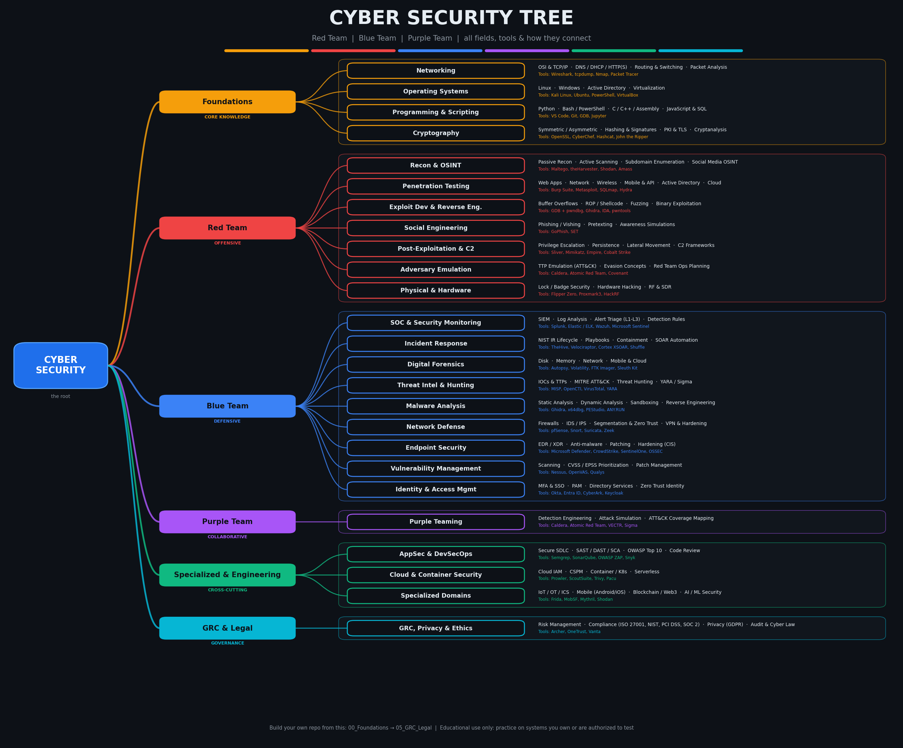
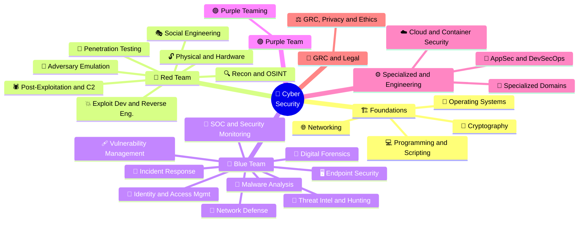
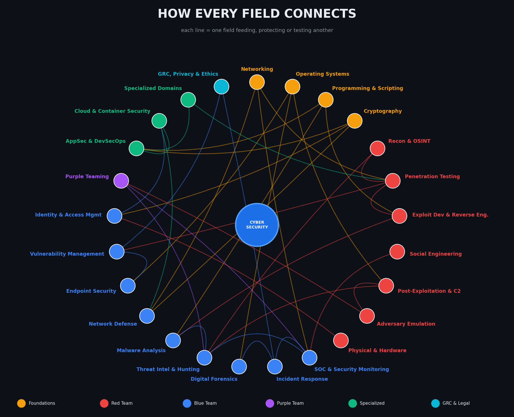
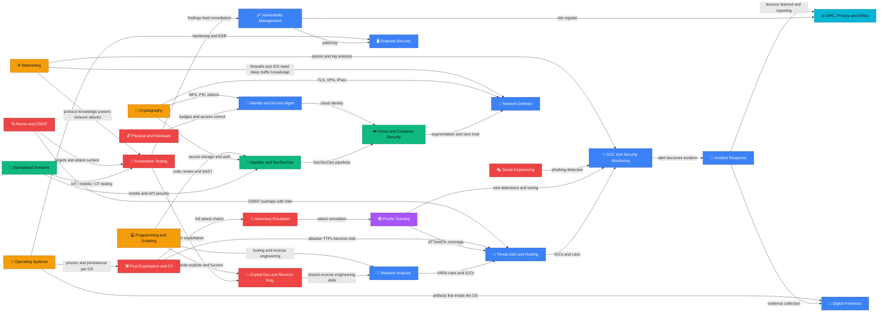
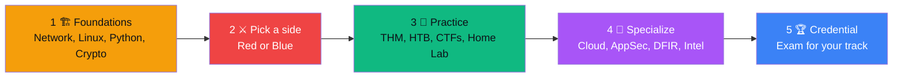

<div align="center">


<a href="https://github.com/Syed-Muhammad-Tayyab">
  
</a>

<br/>


<br/><br/>


<br/><br/>

<a href="#-the-big-picture"><b>🌴 Tree</b></a> &nbsp;•&nbsp;
<a href="#-red-team--offensive"><b>🔴 Red</b></a> &nbsp;•&nbsp;
<a href="#-blue-team--defensive"><b>🔵 Blue</b></a> &nbsp;•&nbsp;
<a href="#-purple-team--collaborative"><b>🟣 Purple</b></a> &nbsp;•&nbsp;
<a href="#-how-everything-is-linked"><b>🔗 Links</b></a> &nbsp;•&nbsp;
<a href="#-folder-structure"><b>📂 Folders</b></a> &nbsp;•&nbsp;
<a href="#-learning--certification-roadmap"><b>🎓 Roadmap</b></a>

</div>

---

## 🌴 The Big Picture

<div align="center">
  
</div>

<div align="center">

| 🖼️ Picture | 📄 PDF Guide | 📊 Slides |
|:---:|:---:|:---:|
| [`cybersecurity_tree.png`](assets/cybersecurity_tree.png) | [`Cybersecurity_Tree.pdf`](docs/Cybersecurity_Tree.pdf) | [`Cybersecurity_Tree.pptx`](docs/Cybersecurity_Tree.pptx) |

</div>

### 🌳 Tree view

```text
🌴 CYBER SECURITY
├── 🏗️ FOUNDATIONS  (Core Knowledge)
│   ├── 🌐 Networking
│   │   ├── OSI & TCP/IP
│   │   ├── DNS / DHCP / HTTP(S)
│   │   ├── Routing & Switching
│   │   └── Packet Analysis
│   ├── 🐧 Operating Systems
│   │   ├── Linux
│   │   ├── Windows
│   │   ├── Active Directory
│   │   └── Virtualization
│   ├── 💻 Programming & Scripting
│   │   ├── Python
│   │   ├── Bash / PowerShell
│   │   ├── C / C++ / Assembly
│   │   └── JavaScript & SQL
│   └── 🔐 Cryptography
│       ├── Symmetric / Asymmetric
│       ├── Hashing & Signatures
│       ├── PKI & TLS
│       └── Cryptanalysis
├── 🔴 RED TEAM  (Offensive)
│   ├── 🔍 Recon & OSINT
│   │   ├── Passive Recon
│   │   ├── Active Scanning
│   │   ├── Subdomain Enumeration
│   │   └── Social Media OSINT
│   ├── 🎯 Penetration Testing
│   │   ├── Web Apps
│   │   ├── Network
│   │   ├── Wireless
│   │   ├── Mobile & API
│   │   ├── Active Directory
│   │   └── Cloud
│   ├── 💥 Exploit Dev & Reverse Eng.
│   │   ├── Buffer Overflows
│   │   ├── ROP / Shellcode
│   │   ├── Fuzzing
│   │   └── Binary Exploitation
│   ├── 🎭 Social Engineering
│   │   ├── Phishing / Vishing
│   │   ├── Pretexting
│   │   └── Awareness Simulations
│   ├── 🕷️ Post-Exploitation & C2
│   │   ├── Privilege Escalation
│   │   ├── Persistence
│   │   ├── Lateral Movement
│   │   └── C2 Frameworks
│   ├── 🥷 Adversary Emulation
│   │   ├── TTP Emulation (ATT&CK)
│   │   ├── Evasion Concepts
│   │   └── Red Team Ops Planning
│   └── 🔓 Physical & Hardware
│       ├── Lock / Badge Security
│       ├── Hardware Hacking
│       └── RF & SDR
├── 🔵 BLUE TEAM  (Defensive)
│   ├── 📡 SOC & Security Monitoring
│   │   ├── SIEM
│   │   ├── Log Analysis
│   │   ├── Alert Triage (L1-L3)
│   │   └── Detection Rules
│   ├── 🚨 Incident Response
│   │   ├── NIST IR Lifecycle
│   │   ├── Playbooks
│   │   ├── Containment
│   │   └── SOAR Automation
│   ├── 🧬 Digital Forensics
│   │   ├── Disk
│   │   ├── Memory
│   │   ├── Network
│   │   └── Mobile & Cloud
│   ├── 🧠 Threat Intel & Hunting
│   │   ├── IOCs & TTPs
│   │   ├── MITRE ATT&CK
│   │   ├── Threat Hunting
│   │   └── YARA / Sigma
│   ├── 🦠 Malware Analysis
│   │   ├── Static Analysis
│   │   ├── Dynamic Analysis
│   │   ├── Sandboxing
│   │   └── Reverse Engineering
│   ├── 🧱 Network Defense
│   │   ├── Firewalls
│   │   ├── IDS / IPS
│   │   ├── Segmentation & Zero Trust
│   │   └── VPN & Hardening
│   ├── 🖥️ Endpoint Security
│   │   ├── EDR / XDR
│   │   ├── Anti-malware
│   │   ├── Patching
│   │   └── Hardening (CIS)
│   ├── 🩹 Vulnerability Management
│   │   ├── Scanning
│   │   ├── CVSS / EPSS Prioritization
│   │   └── Patch Management
│   └── 🪪 Identity & Access Mgmt
│       ├── MFA & SSO
│       ├── PAM
│       ├── Directory Services
│       └── Zero Trust Identity
├── 🟣 PURPLE TEAM  (Collaborative)
│   └── 🟣 Purple Teaming
│       ├── Detection Engineering
│       ├── Attack Simulation
│       └── ATT&CK Coverage Mapping
├── ⚙️ SPECIALIZED & ENGINEERING  (Cross-cutting)
│   ├── 🧪 AppSec & DevSecOps
│   │   ├── Secure SDLC
│   │   ├── SAST / DAST / SCA
│   │   ├── OWASP Top 10
│   │   └── Code Review
│   ├── ☁️ Cloud & Container Security
│   │   ├── Cloud IAM
│   │   ├── CSPM
│   │   ├── Container / K8s
│   │   └── Serverless
│   └── 📱 Specialized Domains
│       ├── IoT / OT / ICS
│       ├── Mobile (Android/iOS)
│       ├── Blockchain / Web3
│       └── AI / ML Security
└── 📜 GRC & LEGAL  (Governance)
    └── ⚖️ GRC, Privacy & Ethics
        ├── Risk Management
        ├── Compliance (ISO 27001, NIST, PCI DSS, SOC 2)
        ├── Privacy (GDPR)
        └── Audit & Cyber Law
```

### 🧭 Mind map



---

## ⚔️ Red vs Blue vs Purple

<div align="center">

| | 🔴 **Red Team** | 🔵 **Blue Team** | 🟣 **Purple Team** |
|:---|:---|:---|:---|
| **Role** | Attacker (authorized) | Defender | Bridge between both |
| **Goal** | Find and prove weaknesses | Prevent, detect, respond | Make detections better |
| **Mindset** | "How can I get in?" | "How do I stop and spot it?" | "Did we catch that? How do we tune it?" |
| **Typical jobs** | Pentester, Red Teamer, Exploit Dev | SOC Analyst, IR, Forensics, Threat Hunter | Detection Engineer |
| **Core tools** | Burp, Metasploit, Sliver | Splunk, Wazuh, Velociraptor | Caldera, Atomic Red Team, Sigma |

</div>

---

## 🏗️ Foundations

 

> The base every security role is built on

| Field | What it covers | Sub-fields | Tools | Certs | Folder |
|:---|:---|:---|:---|:---|:---|
| 🌐 **Networking** | How data moves: the language every attacker and defender speaks. | OSI & TCP/IP • DNS / DHCP / HTTP(S) • Routing & Switching • Packet Analysis | `Wireshark` `tcpdump` `Nmap` `Packet Tracer` | CCNA, Network+ | `Networking/` |
| 🐧 **Operating Systems** | Linux, Windows and Active Directory internals. | Linux • Windows • Active Directory • Virtualization | `Kali Linux` `Ubuntu` `PowerShell` `VirtualBox` | Linux+, LPIC-1 | `Operating_Systems/` |
| 💻 **Programming & Scripting** | Automate, analyze and build security tooling. | Python • Bash / PowerShell • C / C++ / Assembly • JavaScript & SQL | `VS Code` `Git` `GDB` `Jupyter` | PCAP | `Programming_Scripting/` |
| 🔐 **Cryptography** | Protect confidentiality, integrity and authenticity. | Symmetric / Asymmetric • Hashing & Signatures • PKI & TLS • Cryptanalysis | `OpenSSL` `CyberChef` `Hashcat` `John the Ripper` | Crypto I (Coursera) | `Cryptography/` |

---

## 🔴 Red Team — Offensive

 

> Think like the attacker: break in, prove impact

| Field | What it covers | Sub-fields | Tools | Certs | Folder |
|:---|:---|:---|:---|:---|:---|
| 🔍 **Recon & OSINT** | Map the target's attack surface before touching it. | Passive Recon • Active Scanning • Subdomain Enumeration • Social Media OSINT | `Maltego` `theHarvester` `Shodan` `Amass` `Recon-ng` | TCM OSINT | `Recon_OSINT/` |
| 🎯 **Penetration Testing** | Authorized exploitation of web, network and more. | Web Apps • Network • Wireless • Mobile & API • Active Directory • Cloud | `Burp Suite` `Metasploit` `SQLmap` `Hydra` `BloodHound` | eJPT, PNPT, OSCP | `Penetration_Testing/` |
| 💥 **Exploit Dev & Reverse Eng.** | Find memory bugs and turn them into working exploits. | Buffer Overflows • ROP / Shellcode • Fuzzing • Binary Exploitation | `GDB + pwndbg` `Ghidra` `IDA` `pwntools` `AFL++` | OSED, OSEE | `Exploit_Development/` |
| 🎭 **Social Engineering** | Exploit people, the most common entry point. | Phishing / Vishing • Pretexting • Awareness Simulations | `GoPhish` `SET` | SEPP | `Social_Engineering/` |
| 🕷️ **Post-Exploitation & C2** | Escalate, persist, move laterally and control access. | Privilege Escalation • Persistence • Lateral Movement • C2 Frameworks | `Sliver` `Mimikatz` `Empire` `Cobalt Strike` | CRTO, CRTP | `Post_Exploitation_C2/` |
| 🥷 **Adversary Emulation** | Full red-team operations that copy real threat actors. | TTP Emulation (ATT&CK) • Evasion Concepts • Red Team Ops Planning | `Caldera` `Atomic Red Team` `Covenant` | CRTO, CRTL | `Adversary_Emulation/` |
| 🔓 **Physical & Hardware** | Doors, badges, devices and embedded systems. | Lock / Badge Security • Hardware Hacking • RF & SDR | `Flipper Zero` `Proxmark3` `HackRF` | TCM Physical | `Physical_Hardware/` |

---

## 🔵 Blue Team — Defensive

 

> Detect, respond, defend and recover

| Field | What it covers | Sub-fields | Tools | Certs | Folder |
|:---|:---|:---|:---|:---|:---|
| 📡 **SOC & Security Monitoring** | 24/7 eyes on logs and alerts. | SIEM • Log Analysis • Alert Triage (L1-L3) • Detection Rules | `Splunk` `Elastic / ELK` `Wazuh` `Microsoft Sentinel` `QRadar` | Security+, BTL1, SC-200 | `SOC_Monitoring/` |
| 🚨 **Incident Response** | Contain, eradicate and recover from attacks. | NIST IR Lifecycle • Playbooks • Containment • SOAR Automation | `TheHive` `Velociraptor` `Cortex XSOAR` `Shuffle` | GCIH, ECIH | `Incident_Response/` |
| 🧬 **Digital Forensics** | Preserve and analyze evidence. | Disk • Memory • Network • Mobile & Cloud | `Autopsy` `Volatility` `FTK Imager` `Sleuth Kit` | GCFE, GCFA, CHFI | `Digital_Forensics/` |
| 🧠 **Threat Intel & Hunting** | Know the adversary, hunt before alerts fire. | IOCs & TTPs • MITRE ATT&CK • Threat Hunting • YARA / Sigma | `MISP` `OpenCTI` `VirusTotal` `YARA` `Sigma` | GCTI, CTIA | `Threat_Intel_Hunting/` |
| 🦠 **Malware Analysis** | Dissect malicious code to understand and block it. | Static Analysis • Dynamic Analysis • Sandboxing • Reverse Engineering | `Ghidra` `x64dbg` `PEStudio` `ANY.RUN` `Cuckoo` | GREM, eCMAP | `Malware_Analysis/` |
| 🧱 **Network Defense** | Build networks that resist and reveal attacks. | Firewalls • IDS / IPS • Segmentation & Zero Trust • VPN & Hardening | `pfSense` `Snort` `Suricata` `Zeek` `Fortinet` | CCNA Security, NSE 4 | `Network_Defense/` |
| 🖥️ **Endpoint Security** | Protect laptops, servers and phones. | EDR / XDR • Anti-malware • Patching • Hardening (CIS) | `Microsoft Defender` `CrowdStrike` `SentinelOne` `OSSEC` | CySA+ | `Endpoint_Security/` |
| 🩹 **Vulnerability Management** | Find, rank and fix weaknesses continuously. | Scanning • CVSS / EPSS Prioritization • Patch Management | `Nessus` `OpenVAS` `Qualys` | CySA+ | `Vulnerability_Management/` |
| 🪪 **Identity & Access Mgmt** | Right person, right access, right time. | MFA & SSO • PAM • Directory Services • Zero Trust Identity | `Okta` `Entra ID` `CyberArk` `Keycloak` | SC-300, CISSP (IAM) | `Identity_Access/` |

---

## 🟣 Purple Team — Collaborative

 

> Red and Blue working together to improve detection

| Field | What it covers | Sub-fields | Tools | Certs | Folder |
|:---|:---|:---|:---|:---|:---|
| 🟣 **Purple Teaming** | Attack, detect, tune, repeat. | Detection Engineering • Attack Simulation • ATT&CK Coverage Mapping | `Caldera` `Atomic Red Team` `VECTR` `Sigma` | SANS SEC599 | `Purple_Teaming/` |

---

## ⚙️ Specialized & Engineering

 

> Secure-by-design fields that serve both sides

| Field | What it covers | Sub-fields | Tools | Certs | Folder |
|:---|:---|:---|:---|:---|:---|
| 🧪 **AppSec & DevSecOps** | Build security into the software lifecycle. | Secure SDLC • SAST / DAST / SCA • OWASP Top 10 • Code Review | `Semgrep` `SonarQube` `OWASP ZAP` `Snyk` | CSSLP, OSWE | `AppSec_DevSecOps/` |
| ☁️ **Cloud & Container Security** | AWS, Azure, GCP, Docker and Kubernetes. | Cloud IAM • CSPM • Container / K8s • Serverless | `Prowler` `ScoutSuite` `Trivy` `Pacu` | AZ-500, CCSP, AWS Security | `Cloud_Security/` |
| 📱 **Specialized Domains** | IoT, OT/ICS, mobile, blockchain and AI security. | IoT / OT / ICS • Mobile (Android/iOS) • Blockchain / Web3 • AI / ML Security | `Frida` `MobSF` `Mythril` `Shodan` | GICSP, OSMR | `Specialized_Domains/` |

---

## 📜 GRC & Legal

 

> Policies, risk, compliance, audit and ethics

| Field | What it covers | Sub-fields | Tools | Certs | Folder |
|:---|:---|:---|:---|:---|:---|
| ⚖️ **GRC, Privacy & Ethics** | Policy, risk, audit, compliance and the law. | Risk Management • Compliance (ISO 27001, NIST, PCI DSS, SOC 2) • Privacy (GDPR) • Audit & Cyber Law | `Archer` `OneTrust` `Vanta` | CISM, CISA, CISSP, ISO 27001 LA | `GRC_Privacy_Ethics/` |

---

## 🔗 How Everything Is Linked

<div align="center">
  
</div>

### 🕸️ Link graph



<details>
<summary><b>📋 Link table (click to expand)</b></summary>

| From | → | To | Why |
|:---|:---:|:---|:---|
| 🌐 Networking | ➜ | 🎯 Penetration Testing | protocol knowledge powers network attacks |
| 🌐 Networking | ➜ | 🧱 Network Defense | firewalls & IDS need deep traffic knowledge |
| 🌐 Networking | ➜ | 📡 SOC & Security Monitoring | packet & log analysis |
| 🐧 Operating Systems | ➜ | 🕷️ Post-Exploitation & C2 | privesc & persistence per OS |
| 🐧 Operating Systems | ➜ | 🖥️ Endpoint Security | hardening & EDR |
| 🐧 Operating Systems | ➜ | 🧬 Digital Forensics | artifacts live inside the OS |
| 💻 Programming & Scripting | ➜ | 💥 Exploit Dev & Reverse Eng. | write exploits & fuzzers |
| 💻 Programming & Scripting | ➜ | 🧪 AppSec & DevSecOps | code review & SAST |
| 💻 Programming & Scripting | ➜ | 🦠 Malware Analysis | tooling & reverse engineering |
| 🔐 Cryptography | ➜ | 🪪 Identity & Access Mgmt | MFA, PKI, tokens |
| 🔐 Cryptography | ➜ | 🧱 Network Defense | TLS, VPN, IPsec |
| 🔐 Cryptography | ➜ | 🧪 AppSec & DevSecOps | secure storage & auth |
| 🔍 Recon & OSINT | ➜ | 🎯 Penetration Testing | targets & attack surface |
| 🔍 Recon & OSINT | ➜ | 🧠 Threat Intel & Hunting | OSINT overlaps with intel |
| 🎯 Penetration Testing | ➜ | 🩹 Vulnerability Management | findings feed remediation |
| 🎯 Penetration Testing | ➜ | 💥 Exploit Dev & Reverse Eng. | deeper exploitation |
| 💥 Exploit Dev & Reverse Eng. | ➜ | 🦠 Malware Analysis | shared reverse engineering skills |
| 🎭 Social Engineering | ➜ | 📡 SOC & Security Monitoring | phishing detection |
| 🕷️ Post-Exploitation & C2 | ➜ | 🧠 Threat Intel & Hunting | attacker TTPs become intel |
| 🕷️ Post-Exploitation & C2 | ➜ | 🥷 Adversary Emulation | full attack chains |
| 🥷 Adversary Emulation | ➜ | 🟣 Purple Teaming | attack simulation |
| 🟣 Purple Teaming | ➜ | 📡 SOC & Security Monitoring | new detections & tuning |
| 🟣 Purple Teaming | ➜ | 🧠 Threat Intel & Hunting | ATT&CK coverage |
| 📡 SOC & Security Monitoring | ➜ | 🚨 Incident Response | alert becomes incident |
| 🚨 Incident Response | ➜ | 🧬 Digital Forensics | evidence collection |
| 🚨 Incident Response | ➜ | ⚖️ GRC, Privacy & Ethics | lessons learned & reporting |
| 🧠 Threat Intel & Hunting | ➜ | 📡 SOC & Security Monitoring | IOCs & rules |
| 🦠 Malware Analysis | ➜ | 🧠 Threat Intel & Hunting | YARA rules & IOCs |
| 🩹 Vulnerability Management | ➜ | ⚖️ GRC, Privacy & Ethics | risk register |
| 🩹 Vulnerability Management | ➜ | 🖥️ Endpoint Security | patching |
| 🪪 Identity & Access Mgmt | ➜ | ☁️ Cloud & Container Security | cloud identity |
| 🧪 AppSec & DevSecOps | ➜ | ☁️ Cloud & Container Security | DevSecOps pipelines |
| ☁️ Cloud & Container Security | ➜ | 🧱 Network Defense | segmentation & zero trust |
| 🔓 Physical & Hardware | ➜ | 🪪 Identity & Access Mgmt | badges & access control |
| 📱 Specialized Domains | ➜ | 🎯 Penetration Testing | IoT / mobile / OT testing |
| 📱 Specialized Domains | ➜ | 🧪 AppSec & DevSecOps | mobile & API security |

</details>

---

## 🥊 Red vs Blue: The Kill Chain

Every attacker step has a defender answer. This is where **Purple Teaming** lives.

| Phase | 🔴 Red Team does | 🔵 Blue Team answers |
|:---|:---|:---|
| **1. Reconnaissance** | OSINT, scanning, enumeration | Threat intel, honeypots, minimize exposure |
| **2. Weaponization** | Craft payloads & exploits | Malware analysis, YARA, sandboxing |
| **3. Delivery** | Phishing, drive-by, USB | Email gateway, awareness training, web filtering |
| **4. Exploitation** | Abuse a vulnerability | Patching, IPS, hardening, vuln management |
| **5. Installation** | Persistence, backdoors | EDR, app allow-listing, integrity monitoring |
| **6. Command & Control** | Beacon to C2 server | DNS sinkhole, egress filtering, NDR |
| **7. Actions on Objectives** | Exfiltration, ransomware | DLP, backups, incident response, forensics |

---

## 📂 Folder Structure

Which field lives in which folder. Each leaf folder can hold `notes/`, `labs/`, `tools/`, `cheatsheets/` and `writeups/`.

```text
📦 Cybersecurity/
├── 📁 00_Foundations/   # 🏗️ Core Knowledge
│   ├── 📁 Networking/
│   ├── 📁 Operating_Systems/
│   ├── 📁 Programming_Scripting/
│   └── 📁 Cryptography/
├── 📁 01_Red_Team/   # 🔴 Offensive
│   ├── 📁 Recon_OSINT/
│   ├── 📁 Penetration_Testing/
│   ├── 📁 Exploit_Development/
│   ├── 📁 Social_Engineering/
│   ├── 📁 Post_Exploitation_C2/
│   ├── 📁 Adversary_Emulation/
│   └── 📁 Physical_Hardware/
├── 📁 02_Blue_Team/   # 🔵 Defensive
│   ├── 📁 SOC_Monitoring/
│   ├── 📁 Incident_Response/
│   ├── 📁 Digital_Forensics/
│   ├── 📁 Threat_Intel_Hunting/
│   ├── 📁 Malware_Analysis/
│   ├── 📁 Network_Defense/
│   ├── 📁 Endpoint_Security/
│   ├── 📁 Vulnerability_Management/
│   └── 📁 Identity_Access/
├── 📁 03_Purple_Team/   # 🟣 Collaborative
│   └── 📁 Purple_Teaming/
├── 📁 04_Specialized_Engineering/   # ⚙️ Cross-cutting
│   ├── 📁 AppSec_DevSecOps/
│   ├── 📁 Cloud_Security/
│   └── 📁 Specialized_Domains/
├── 📁 05_GRC_Legal/   # 📜 Governance
│   └── 📁 GRC_Privacy_Ethics/
├── 📁 06_Certs_Roadmap/   # Study plans, exam notes, voucher tracking
├── 📁 07_Labs_CTF/   # HTB, THM, PicoCTF write-ups, home-lab builds
├── 📁 08_Tools/   # Cheat sheets, scripts, tool configs
└── 📁 09_Resources/   # Books, courses, frameworks (ATT&CK, NIST, OWASP)
```

---

## 🎓 Learning & Certification Roadmap

| Track | Certifications |
|:---|:---|
| 🟡 **Beginner** | Security+, CEH, eJPT, CC (ISC2), Google Cybersecurity |
| 🔴 **Red Path** | PNPT, OSCP, CRTO, OSWE, OSED |
| 🔵 **Blue Path** | BTL1, CySA+, GCIH, GCFA, SC-200 |
| 🔷 **Management** | CISSP, CISM, CISA, CCSP |



**Practice platforms:** `TryHackMe` • `HackTheBox` • `PicoCTF` • `OverTheWire` • `PortSwigger Academy` • `CyberDefenders` • `LetsDefend` • `Blue Team Labs Online`

---

## ⚠️ Disclaimer

<div align="center">

**This repository is for education only.** Practice on systems you own or have **written permission** to test.
Misuse of offensive techniques is illegal and the author takes no responsibility for it.

</div>

---

## 🤝 Connect

<div align="center">

<a href="https://github.com/Syed-Muhammad-Tayyab"></a>

⭐ **If this tree helped you, give the repo a star!** ⭐


</div>
